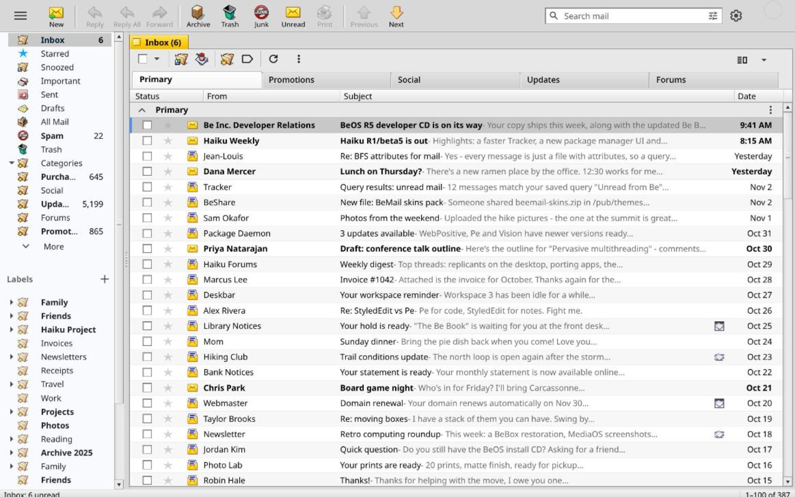

# Haiku (BeOS) Theme for Gmail

A browser extension for Chrome and Firefox that makes Gmail look and behave like a native
[Haiku](https://www.haiku-os.org/) (BeOS-lineage) mail client, modelled on
Haiku Mail (BeMail), Beam and Haiku's interface guidelines.



**Current version: 1.1.1.** See the [changelog](CHANGELOG.md) for what's new.

- **BeMail toolbar**: New, Reply, Reply All, Forward, Archive, Trash, Junk,
  Unread, Print, Previous, Next. Each button presses Gmail's own control, so
  Gmail still does the work.
- **Yellow window tab** over the message pane, titled with the folder or the
  open message's subject.
- **Tracker-style message list**: 22px rows, column headers, Haiku status
  icons and stars.
- **Haiku controls** throughout: bevelled push buttons, sunken text fields,
  Haiku radio buttons, checkboxes, scrollbars, menus and tab views.
- **Beam-style message header**, a framed calendar-invitation box, and a
  BeMail compose window with "To:" and "Subject:" labels.
- **Resizable folder panel** and a status bar showing the unread count and
  position.
- **New messages open in a BeMail-style compose window** inside Gmail. Replies and
  forwards stay in the thread; Gmail's pop-out button still works on them.
- **The tab's close box closes the current view**: an open message goes back
  to its list, Settings or a search back to the Inbox.
- **Narrow windows** trim the toolbar to the most-used buttons.
- Gmail extras with no BeOS counterpart are hidden: the Google apps grid,
  Gemini, Chat/Meet, emoji reactions and the Material ripples.

Everything happens locally in your browser. The extension requests no
permissions beyond running on `mail.google.com`. It collects no data and
makes no network requests.

## Install

Downloads are on the
[latest release](https://github.com/ojdorson/haiku-theme-for-gmail/releases/latest).

### Firefox

Download `haiku-theme-for-gmail-<version>.xpi` (signed by Mozilla) and open
it in Firefox, or drag it onto a Firefox window, then confirm **Add**.
Reload Gmail. Firefox 121 or later; it should also work in Haiku's Firefox.

### Chrome, Chromium, Brave, Edge, Vivaldi

**Chrome Web Store:** in review; a one-click install link will appear here.

Until then:

1. Download `haiku-theme-for-gmail-<version>-chrome.zip` and unzip it.
2. Open `chrome://extensions`, turn on **Developer mode** (top right), click
   **Load unpacked** and choose the unzipped folder.
3. Reload Gmail.

A manual install doesn't update itself: download the new release to update.
When you switch to the Chrome Web Store version, remove the manual copy first.

## Notes and limitations

- **English Gmail interface only.** The toolbar finds Gmail's buttons by
  their English labels.
- **Tested with Gmail's default density and default (non-split) inbox
  layout.** Other layouts work but are less polished.
- **Message bodies keep the sender's own formatting.** Only Gmail's interface
  is restyled.
- **Gmail updates may break parts of the look.** Gmail changes its
  obfuscated class names from time to time. Those selectors are collected
  in the `BRITTLE` section of `haiku.css`, which is the first place to look.

## Development

The working folder is the development build. It also loads `dev-bg.js` and
`dev-content.js`, which connect to a local tuning server:

```sh
python3 tools/devserver.py            # hot-swaps haiku.css into open Gmail tabs,
                                      # reloads the extension on other changes
python3 tools/ask.py '{"selectors": ["tr.zA"], "limit": 2}'   # inspect Gmail's DOM
python3 tools/build.py                # Chrome and Firefox builds in dist/ (no dev files)
```

`tools/ask.py` returns tags, classes, geometry and computed styles, never
message contents. See its docstring for the query keys.

## Credits

The icons are Haiku's own, distributed under the MIT License. See
[CREDITS.md](CREDITS.md). Gmail is a trademark of Google LLC. This project
is not affiliated with Google or with Haiku, Inc. BeOS is a trademark of its
respective owner; the name describes the look this theme recreates.
